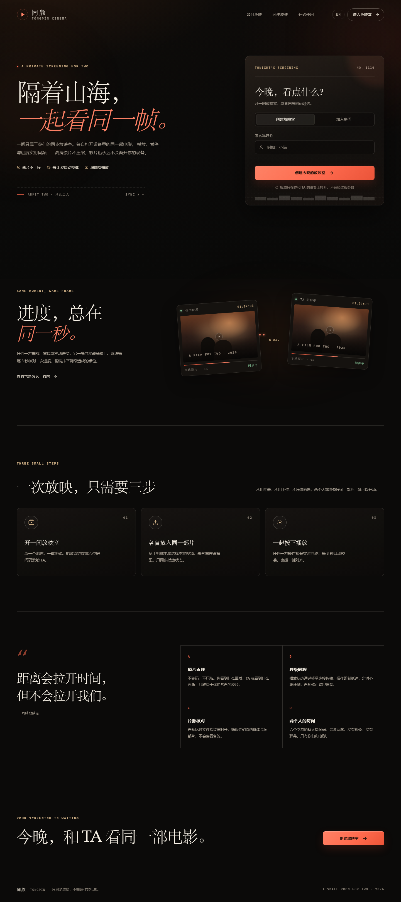
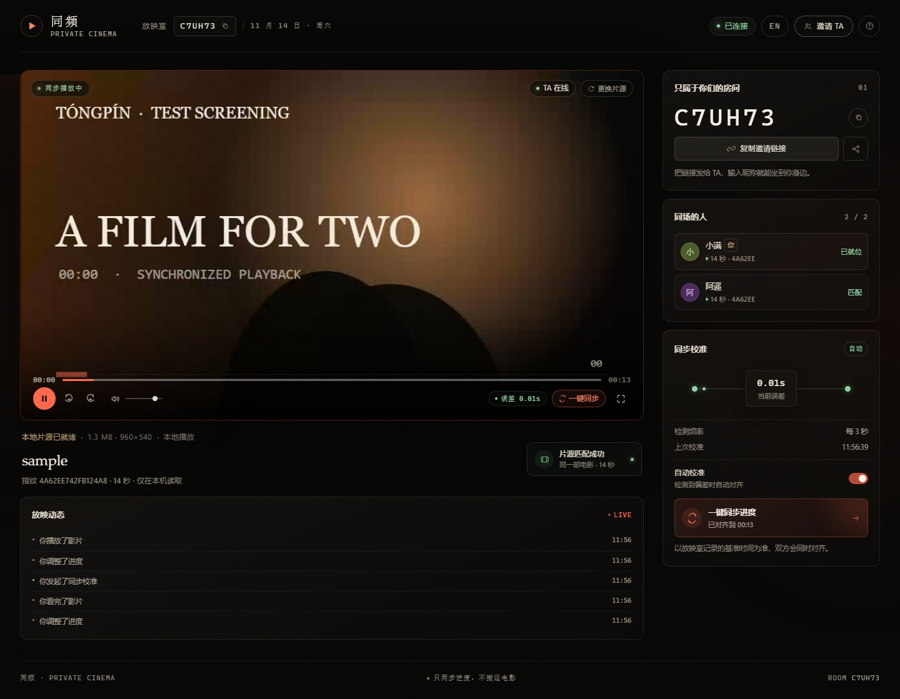
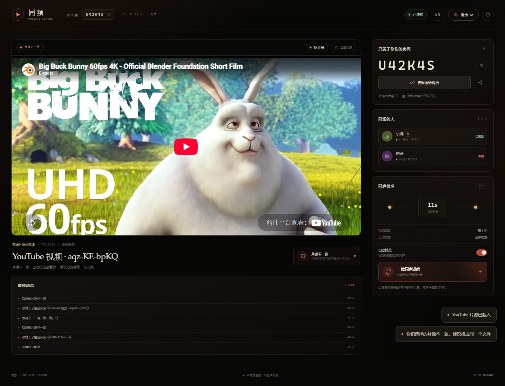
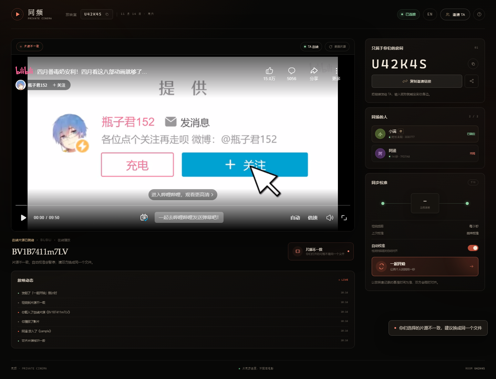
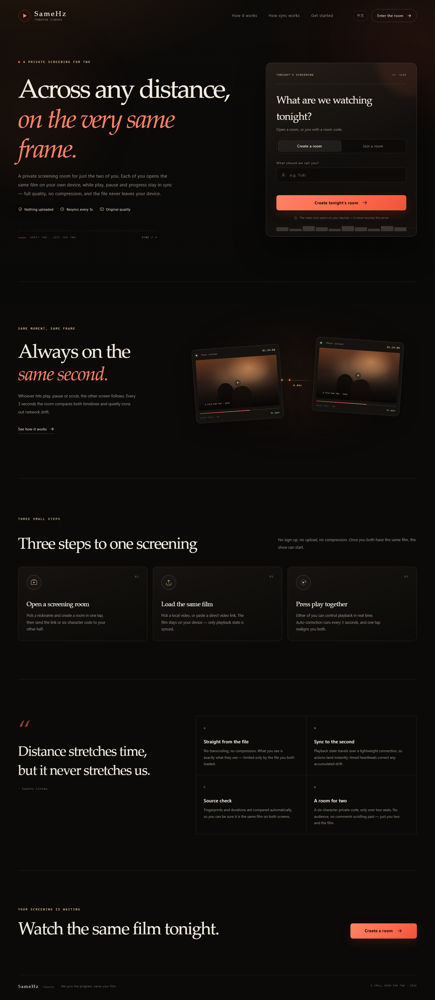
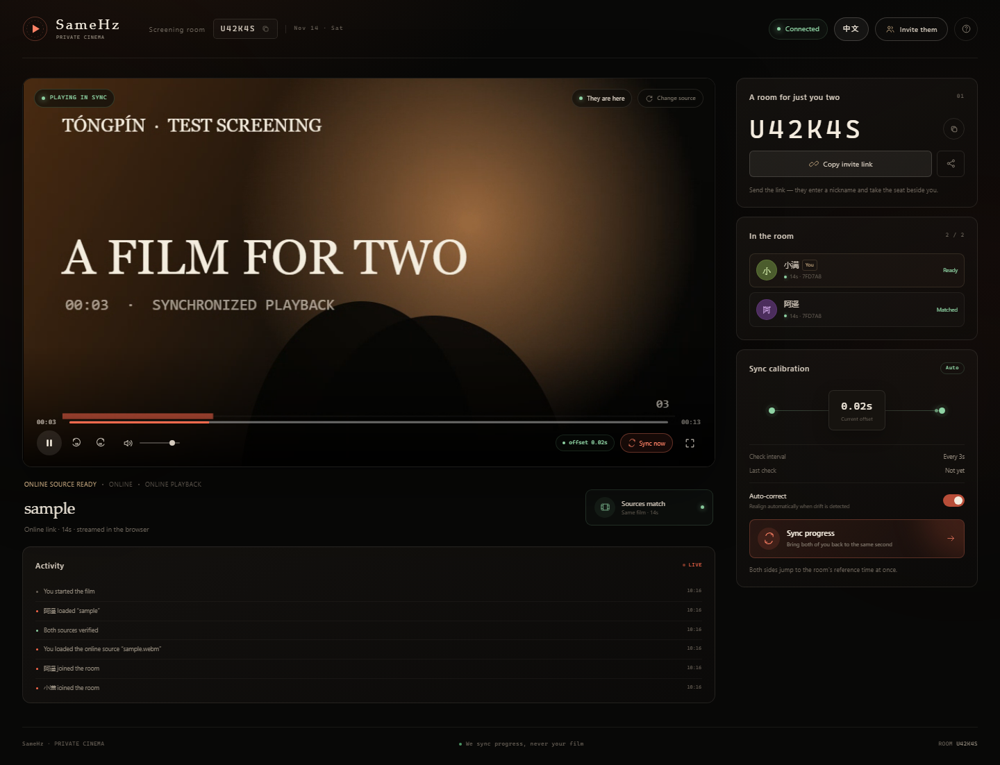

# 同频 · SameHz

一间只属于两个人的私人同步放映室。两个人在不同设备、不同地点打开同一部电影，播放、暂停、拖动进度会实时同步；每 3 秒自动检测一次偏差并校准，也可以一键手动对齐。

片源有两种方式：**各自打开本地文件**，或者**粘贴同一个视频直链**（MP4 / WebM / HLS）。

**影片不会上传服务器。** 服务端只保存房间与播放状态，视频始终留在各自的设备上，或者由浏览器直接从源站加载，因此没有画质压缩，也不占用服务器带宽。

界面支持**中文 / English** 切换，语言偏好会记住。



## 功能

- 六位房间码 / 邀请链接，两人入座，无需注册
- 三种片源：本地视频（MP4 / WebM / MOV 等）、在线直链（MP4 / WebM / HLS）、流媒体平台链接（YouTube 完整同步；Bilibili / Vimeo 嵌入播放）
- 粘贴其他视频网站页面链接时，服务器会尝试解析出可直接播放的流地址
- 一方粘贴链接后，另一方会自动载入同一条链接
- 「一起开始」倒计时，让无法程序化控制的平台也能同时起播
- 自动比对片源指纹与时长，提示双方是否在看同一个片源
- 播放、暂停、拖动进度双向实时同步
- 每 3 秒心跳检测，偏差超过阈值自动校准
- 一键同步进度，双方同时对齐到放映室基准时间
- 自动校准开关、当前误差、上次校准时间、放映动态
- 中英文切换（跟随浏览器语言，也可手动切换并记住选择）
- 连接中断自动重连，移动端适配
- 本地读取视频，服务端不接收、不转码、不存储影片



粘贴 YouTube 链接，双方完整同步：



Bilibili 等平台以嵌入播放 +「一起开始」倒计时对齐：



英文界面：





## 技术结构

```text
server.js          Node.js HTTP + WebSocket 服务
lib/resolve.js     网页视频解析（yt-dlp + 通用抓取，只解析不代理）
public/            无框架前端（原生 HTML / CSS / JavaScript）
  index.html       落地页
  room.html        同步放映室
  css/
  js/
    i18n.js        中英文词典与 DOM 翻译运行时
    landing.js     首页交互
    room.js        放映室：片源载入、同步、校准
tools/             协议测试、解析测试、新功能回归、双浏览器端到端测试
test/sample.webm   端到端测试用短视频
```

部署镜像里已自带 `yt-dlp`（见 `Dockerfile`），本地开发时如果没装 yt-dlp，解析会自动退回通用抓取。

服务端使用内存中的房间对象维护：

- 房间成员（最多 2 人）
- 片源指纹、时长与来源类型（`local` / `url` + 链接）
- 权威播放状态 `{ playing, position, updatedAt, revision }`
- 任何一方操作后，服务端更新时间戳并广播
- 客户端用 WebSocket 往返估算时钟偏移，按权威时间戳推算当前应处的位置
- 客户端每 3 秒发送一次心跳，服务端返回当前基准位置；偏差超过 0.85 秒（或播放状态不一致）时自动 seek 对齐
- 手动同步请求会广播 `force-sync`，双方同时对齐

在线片源的指纹由链接本身推导（同一链接 → 同一指纹），因此双方粘贴同一条链接即可判定为「片源匹配」。服务端只转发链接字符串，不会代理视频流。

## 本地运行

要求 Node.js 18+。

```bash
npm install
npm start
```

打开终端输出的地址：

- 本机：`http://localhost:3000`
- 局域网：`http://<本机局域网 IP>:3000`（两台设备需在同一网络）

使用步骤：

1. 一个人填写昵称，创建放映室。
2. 点击「邀请 TA」，把链接或六位房间码发给另一个人。
3. 另一个人打开链接，输入昵称入座。
4. 两个人在各自设备上打开**同一个片源**：同一个本地文件，或者粘贴同一条视频直链。
5. 任意一方播放、暂停或拖动进度，另一方会跟随。
6. 如果出现偏差，点击「一键同步进度」。

> 本地文件的指纹由文件大小、首尾 1 MB 数据与时长共同核对；在线链接的指纹由链接本身推导。只有双方打开的是同一个片源，同步才有意义。

### 关于在线视频

支持三类链接：

| 类型 | 示例 | 同步能力 |
| --- | --- | --- |
| 视频直链 | `https://cdn.example.com/movie.mp4`、`.webm`、`.m3u8`（HLS） | 完整同步：播放、暂停、跳转、自动校准 |
| YouTube | `https://www.youtube.com/watch?v=…`、`youtu.be/…`、Short（Shorts） | 完整同步：通过官方 IFrame API 控制并读取进度 |
| Bilibili / Vimeo | `https://www.bilibili.com/video/BV…`、`https://vimeo.com/…` | **仅嵌入**：平台未提供可控接口，使用「一起开始」倒计时同时按下播放 |
| 其他视频网站页面 | 例如 `https://example.com/video/12345` | 服务器尝试解析出直链（见下），成功后按直链完整同步 |

### 网页视频解析（方案 A：只解析，不代理）

粘贴一个**视频网站页面链接**时，服务器会尝试找出可以直接播放的流地址，再把地址交回浏览器播放：

1. 优先调用 **yt-dlp**（覆盖上千个站点），取音视频合一的渐进流或 HLS；
2. yt-dlp 不支持时，退回**通用抓取**：读取页面里的 `og:video`、`<video>/<source src>`、JSON-LD `contentUrl`，以及页面代码里明文出现的 `.m3u8` / `.mp4`（含 `\u002F` 转义）。

**关键限制：**

- 只解析，不下载、不转码、不代理。视频由浏览器直接从源站拉取，**不消耗本站带宽**。
- 如果源站校验 `Referer` / `Cookie`，浏览器直连可能失败 —— 这种情况需要「服务器代理流」，会消耗服务器带宽，本方案**不包含**。
- 需要登录、使用 DRM 加密，或采用动态签名并有反爬的站点通常无法解析，会给出明确提示。
- 爱一番这类站能否成功取决于其页面结构与 yt-dlp 的通用提取器，不保证；失败时会明确提示，而不是一直转圈。
- 受 DRM 保护的平台（Netflix、Disney+、爱奇艺、优酷、腾讯视频等）直接拒绝：浏览器不允许第三方控制其播放器。

- 一方载入链接后，另一方会自动采用同一条链接。
- 视频由浏览器直接从源站加载，不经过本站服务器，不消耗本站带宽。
- 内嵌平台本身的广告、地区限制、会员限制由平台决定。

## 部署到公网（真正异地使用）

这是一个标准 Node.js 服务，可部署到任意支持 WebSocket 的 VPS / Render / Railway / Fly.io。

**必须让 WebSocket 可升级。** 使用 Nginx 反向代理时至少需要：

```nginx
server {
    listen 443 ssl;
    server_name cinema.example.com;

    location / {
        proxy_pass http://127.0.0.1:3000;
        proxy_http_version 1.1;
        proxy_set_header Upgrade $http_upgrade;
        proxy_set_header Connection "upgrade";
        proxy_set_header Host $host;
        proxy_set_header X-Forwarded-For $proxy_add_x_forwarded_for;
    }
}
```

生产环境建议启用 HTTPS，这样页面会使用 `wss://`，剪贴板等浏览器能力也更完整。

### Docker

```bash
docker build -t tongpin .
docker run -d --name tongpin -p 3000:3000 -e PORT=3000 tongpin
```

## 测试

先启动服务，再运行：

```bash
# WebSocket 协议测试
npm run test:protocol

# 网页视频解析测试（自带本地测试站）
npm run test:resolve

# 新功能回归：中英文切换 + 在线链接播放
npm run test:features

# 双浏览器端到端测试（需要 Chrome + playwright-core）
npm run test:e2e

# 重新生成测试用短视频（可选）
npm run sample
```

如果你的 Chrome 不在默认路径，设置 `CHROME_PATH`：

```bash
# Windows PowerShell
$env:CHROME_PATH='C:\Program Files\Google\Chrome\Application\chrome.exe'
npm run test:e2e
```

端到端测试会验证：双人入座、双方载入同一片源、播放/暂停/拖动同步、4 秒偏差自动校准、手动同步与页面无异常。

新功能回归测试（`npm run test:features`）会额外启动一个临时的本地静态服务提供在线片源，验证：中英文切换双向还原、平台链接识别（YouTube / Bilibili / 不支持平台）、直链片源载入、对方自动采用同一条链接、链接片源同步、Bilibili 嵌入与「一起开始」倒计时、YouTube 播放器挂载、放映室内切换语言不中断播放。

## 已知边界

- 房间数据保存在内存中，服务重启后会清空；不做多实例扩展。
- 双方设备都必须打开同一个片源；服务端不转发视频内容。
- 浏览器能否播放取决于文件编码，推荐 MP4（H.264 + AAC）或 WebM（VP8/VP9）。
- HLS 链接依赖 CDN 上的 hls.js；若该 CDN 被阻断，`.m3u8` 将无法播放，MP4 / WebM 直链不受影响。
- YouTube 依赖官方 IFrame API（`youtube.com/iframe_api`）与可嵌入的视频；地区限制、版权限制、禁止嵌入的视频无法播放。
- Bilibili / Vimeo 只能嵌入，无法读取或控制播放进度，因此用「一起开始」倒计时对齐，不做自动校准。
- 网页解析依赖外网可达与 yt-dlp；Render 免费层出站带宽有限，但因为**只解析不代理**，只有解析时的 HTML 请求会计入。
- 受 DRM 保护的平台（Netflix、Disney+、爱奇艺、优酷等）无法支持，浏览器不允许第三方控制其播放器。
- 房间最多两人，这是产品设定；离开后空位保留约 12 秒以便刷新重连。
- 自动校准阈值为 `0.85` 秒，可在 `public/js/room.js` 的 `AUTO_SYNC_THRESHOLD` 调整。

## 多语言

- 词典与运行时在 `public/js/i18n.js`，以中文原文为键，`t('中文模板', { 变量 })` 取译文。
- 静态文案通过 DOM 翻译（`I18N.apply()`），切换语言可精确还原，不刷新页面。
- 动态文案在切换语言后由各页面重新渲染；语言选择保存在 `localStorage` 的 `tp:lang`。
- 也可用 `?lang=en` / `?lang=zh` 强制指定语言。

## 隐私

服务端接收并保存的只有：昵称、房间码、片源文件名、文件大小、时长、非加密的片源指纹（在线片源则保存链接本身），以及播放进度。视频本体永远不会离开你的设备，也不会经过本站服务器转发。
